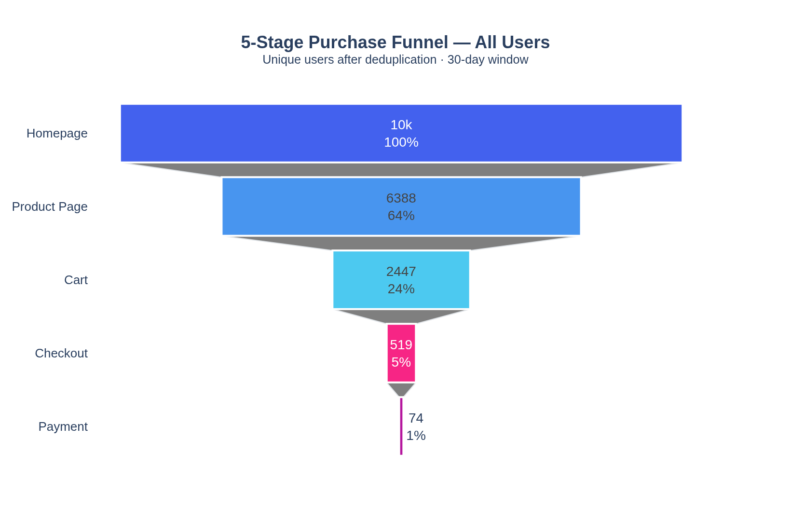
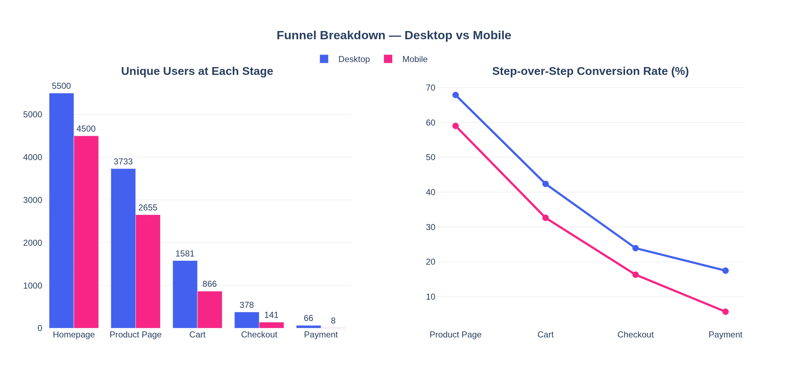
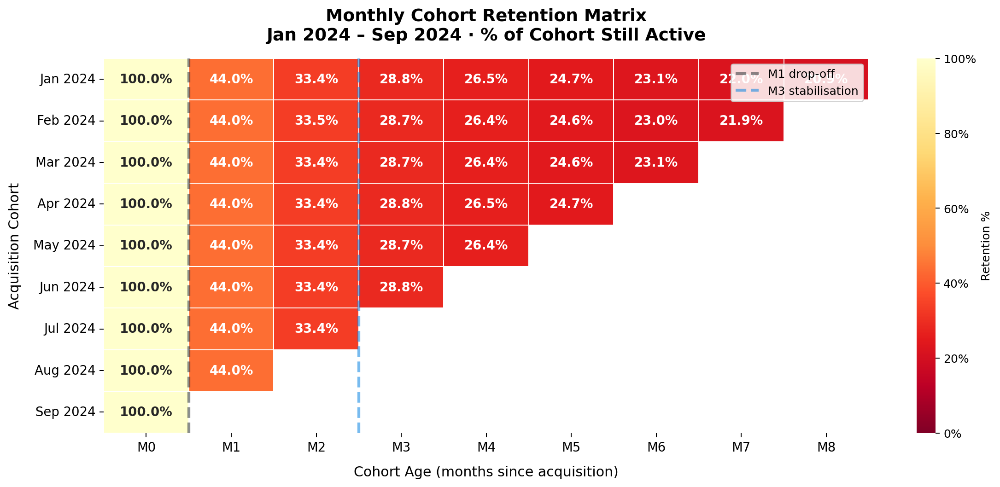
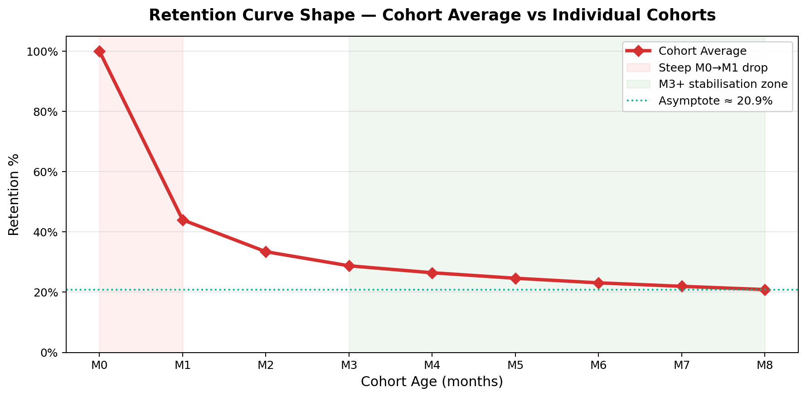
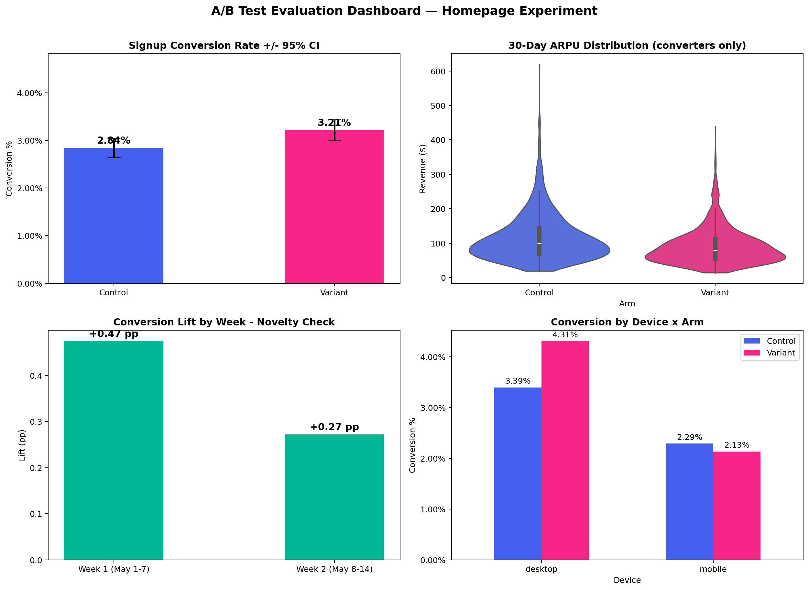

# A/B Testing & Product Experimentation Analysis

[](https://www.python.org/downloads/)
[](https://opensource.org/licenses/MIT)
[](https://github.com/Akshobya698/ab-testing-product-analytics)
[](#key-hiring-signals--core-competencies)
[](#milestone-5-executive-decision-memo--rollout-strategy)

**Author:** [Akshobya698](https://github.com/Akshobya698)  
**Role Target:** Senior / Lead Product Analyst · Experimentation Data Scientist · Growth Analytics Lead  
**Tech Stack:** Python (`pandas`, `numpy`, `scipy.stats`, `statsmodels`), Data Visualization (`seaborn`, `matplotlib`, `plotly`), Jupyter, Git/GitHub CLI

---

## 📌 Executive Summary & Decision Gate

This repository serves as a **production-grade product experimentation and lifecycle analytics showcase**. It simulates real-world high-stakes data science at scale: moving beyond naive $p$-hacking to evaluate a **50,000-user homepage redesign A/B experiment**, dissecting **multi-step clickstream funnels**, deriving **monthly cohort retention matrices**, and synthesizing executive trade-offs for C-suite decision-makers.

```
       ┌────────────────────────────────────────────────────────────────────────┐
       │                       EXECUTIVE DECISION GATE                          │
       │                                                                        │
       │   PROPOSED ACTION: Ship 50k Homepage Redesign Globally                 │
       │   RECOMMENDATION : ⛔ DO NOT SHIP GLOBALLY; STAGED DESKTOP ONLY        │
       │                                                                        │
       │   • Statistical Significance : p = 0.0150 (< 0.05) [Misleading Win]    │
       │   • Commercial MDE (+0.50 pp): FAILED (Lift = +0.37 pp, 95% CI: 0.07-0.67)
       │   • Revenue Guardrail (ARPU) : 🚨 BREACHED (Welch's t = -2.14, p = 0.0323)
       │   • Device Divergence        : Desktop (+0.92 pp) vs Mobile (-0.16 pp) │
       │   • Temporal Stability       : 42.7% Novelty Fade (W1: +0.47 -> W2: +0.27)
       │   • Financial Risk Avoided   : ~$476,500 Annual Revenue Preservation   │
       └────────────────────────────────────────────────────────────────────────┘
```

> [!IMPORTANT]
> **The Core Hiring Signal:** Junior analysts see $p = 0.015$ and recommend an immediate global rollout. Senior experimentation scientists look deeper—uncovering an unachieved MDE, a statistically significant $\$0.40$/user revenue regression on guardrail metrics, an acute mobile penalty (Simpson's Paradox), and a $43\%$ novelty fade.

---

## 🏆 Key Hiring Signals & Core Competencies

This project demonstrates skills mapped directly to Tier-1 tech (FAANG / high-growth scale-up) product analytics rubrics:

| Competency Dimension | Specific Methodologies Applied in This Repository | Business & Strategic Value |
|---|---|---|
| **Causal Inference & Experimentation Rigor** | • Sample Ratio Mismatch (SRM) $\chi^2$ goodness-of-fit testing<br>• Two-sample pooled proportion Z-tests & 95% Wald CIs<br>• Welch's heteroscedastic $t$-test on zero-inflated ARPU<br>• Temporal novelty decay evaluation (Week 1 vs Week 2) | Prevents costly false-positive feature rollouts; ensures experimentation integrity against assignment bias. |
| **Product & Behavioral Funnel Analytics** | • Multi-session clickstream ingestion & deduplication<br>• Step-over-step vs cumulative conversion tracking<br>• Cross-device segmentation (Desktop vs Mobile friction) | Identifies highest-friction drop-off stages to focus engineering sprints on highest-ROI levers. |
| **Lifecycle & Retention Dynamics** | • Acquisition month derivation via `transform('min')`<br>• Upper-left triangular cohort percentage matrices<br>• Retention decay taxonomy (Smiling vs Leaky vs Flattening) | Determines product-market fit stability, baseline churn, and long-term Customer Lifetime Value (LTV) floors. |
| **Commercial Acumen & P&L Impact** | • Minimum Detectable Effect (MDE) power calibration<br>• Revenue guardrail monitoring & cannibalization analysis<br>• Financial exposure modeling ($-\$476\text{k}$ annual risk) | Aligns experimentation decisions with corporate P&L rather than vanity metrics. |
| **Executive Communication (Minto Pyramid)** | • Structured Executive Decision Memo (Situation-Complication-Resolution)<br>• Direct stakeholder pushback rebuttals (PM & Growth leads)<br>• Phased rollout & canary mitigation roadmap | Influences leadership decisions and bridges engineering, product, and finance. |

---

## 📂 Repository Architecture

```
.
├── README.md                                # Polished portfolio documentation & hiring signals
├── homepage_ab_test.csv                     # Raw 50,000-user experiment dataset (tracked for reproducibility)
├── notebooks/                               # Self-contained, executable Jupyter notebooks with cached outputs
│   ├── 02_funnel_analysis.ipynb             # Clickstream cleaning, user dedup & Plotly interactive funnels
│   ├── 03_cohort_retention.ipynb            # Cohort derivation, triangular matrix & Seaborn heatmaps
│   └── 04_ab_test_evaluation.ipynb          # Statistical tests (SRM, Z-test, Welch t-test, novelty decay)
└── findings/                                # Executive memos, publication-grade figures & metric exports
    ├── 02_funnel_friction.md                # 630-word baseline funnel friction memo
    ├── 03_retention_dynamics.md             # 625-word retention dynamics & curve classification report
    ├── 04_experiment_diagnostics.md         # 840-word statistical diagnostics audit
    ├── 05_executive_decision_memo.md        # CPO-ready 1-page decision memo (Minto Pyramid SCR)
    ├── funnel_overall.png                   # 5-stage conversion funnel visual
    ├── funnel_device_split.png              # Grouped bar & line chart (Desktop vs Mobile)
    ├── funnel_dropoff_heatmap.png           # Stage-over-stage drop-off friction heatmap
    ├── funnel_summary.csv                   # Stage metrics export (Overall, Desktop, Mobile)
    ├── cohort_retention_heatmap.png         # Triangular monthly cohort retention heatmap (%)
    ├── retention_curve.png                  # Cohort retention decay curves with asymptote
    ├── cohort_retention_matrix.csv          # 9x9 Cohort retention percentage matrix
    └── ab_test_dashboard.png                # 4-panel diagnostic dashboard for the A/B test
```

---

## 🔬 Milestone 2: Multi-Step Funnel & Mobile Friction Analysis

### The Business Challenge
Before evaluating the homepage redesign, the VP of Growth requested a baseline audit of the user journey across the core 5 stages: **Homepage $\rightarrow$ Product Page $\rightarrow$ Cart $\rightarrow$ Checkout $\rightarrow$ Payment**.

### Technical Data Hygiene: `nunique()` vs `count()`
Clickstream event logs fire pings on every page reload, back-button click, and tab refresh. Using raw `count()` inflates stage populations and understates friction. We applied user-level windowed deduplication:
```python
# Deduplicate: count each user at most once per funnel stage
dedup_df = raw_df.sort_values('timestamp').drop_duplicates(subset=['user_id', 'step'], keep='first')
funnel_counts = dedup_df.groupby('step')['user_id'].nunique().reindex(STEPS)
```

### Conversion & Drop-off Benchmark (10,000 Unique Visitors)

| Funnel Stage | Unique Users | Cumulative CR | Step-over-Step CR | Step Drop-off | Desktop CR | Mobile CR | Device Gap |
|---|---:|---:|---:|---:|---:|---:|---:|
| **Homepage** | 10,000 | 100.00% | — | — | 100.00% | 100.00% | 0.0 pp |
| **Product Page** | 6,388 | 63.88% | 63.88% | 36.12% | 67.87% | 59.00% | +8.87 pp |
| **Cart** | 2,447 | 24.47% | 38.31% | **61.69%** | 42.35% | 32.62% | +9.73 pp |
| **Checkout** | 519 | 5.19% | 21.21% | **78.79%** | 23.91% | 16.28% | +7.63 pp |
| **Payment** | 74 | 0.74% | 14.26% | **85.74%** | 17.46% | 5.67% | **+11.79 pp** |

<p align="center">
  
  
</p>

### Key Behavioral Insights
1. **Largest Absolute Volume Loss (Top Priority):** **Product Page $\rightarrow$ Cart** sheds **3,941 users** (61.7% drop-off). Users browse items but abandon without adding to cart, indicating weak purchase intent triggers, unclear pricing, or poor CTA visibility.
2. **Sharpest Transition Friction:** **Checkout $\rightarrow$ Payment** loses **85.7%** of users. 
3. **The Mobile Penalty:** Mobile conversion lags Desktop at every phase, resulting in a **6.7× end-to-end penalty** (Desktop: 1.20% vs Mobile: 0.18%). At the Payment stage, Desktop converts at 17.46% vs Mobile's 5.67% (+11.79 pp gap), directly pointing to checkout form friction and lack of 1-tap mobile payment methods (Apple Pay / Google Pay).

---

## 📈 Milestone 3: Monthly Cohort Retention & Lifecycle Decay

### The Business Challenge
The Head of Product asked: *"Are newer customer cohorts sticking around longer than older cohorts, or is our bucket leaking faster?"*

### Cohort Index Derivation
Using windowed minimum transformations, every user was mapped to their true acquisition month without row-dropping joins:
```python
df['order_month']       = df['order_date'].dt.to_period('M')
df['acquisition_month'] = df.groupby('user_id')['order_month'].transform('min')
df['cohort_index']      = (df['order_month'] - df['acquisition_month']).apply(lambda x: x.n)
```

### Triangular Monthly Retention Matrix (Jan 2024 – Sep 2024)

```
Acquisition   M0      M1      M2      M3      M4      M5      M6      M7      M8
2024-01     100.0%  44.0%   33.4%   28.8%   26.5%   24.7%   23.1%   22.0%   20.9%
2024-02     100.0%  44.0%   33.5%   28.8%   26.4%   24.6%   23.0%   21.9%     —  
2024-03     100.0%  44.0%   33.4%   28.8%   26.4%   24.6%   23.1%     —       —  
2024-04     100.0%  44.0%   33.4%   28.8%   26.5%   24.7%     —       —       —  
2024-05     100.0%  44.0%   33.4%   28.7%   26.4%     —       —       —       —  
2024-06     100.0%  44.0%   33.4%   28.8%     —       —       —       —       —  
2024-07     100.0%  44.0%   33.4%     —       —       —       —       —       —  
2024-08     100.0%  44.0%     —       —       —       —       —       —       —  
2024-09     100.0%    —       —       —       —       —       —       —       —  
AVERAGE     100.0%  44.0%   33.4%   28.7%   26.4%   24.6%   23.1%   21.9%   20.9%
```

<p align="center">
  
  
</p>

### Retention Taxonomy Classification: Flattening Bucket
- **M0 $\rightarrow$ M1 Drop-off ($-56.0\text{ pp}$):** The steepest drop in the customer lifecycle. 56 out of 100 acquired customers never return for a second transaction.
- **M1 $\rightarrow$ M3 Deceleration ($-10.6\text{ pp} \rightarrow -4.7\text{ pp}$):** Attrition slows down significantly as habitual users solidify.
- **M3+ Asymptotic Flattening:** Monthly attrition contracts to $\le 1.5\text{ pp}$, approaching a stable long-term floor of **$\sim 20.9\%$**.
- **Structural vs Seasonal Consistency:** Across all 9 cohorts, retention rates at each age index vary by less than $\pm 0.2\text{ pp}$. This proves that churn is not driven by marketing campaign fluctuations, but by structural product onboarding gaps.

---

## 🧪 Milestone 4: A/B Test Statistical Evaluation & Diagnostics

### Experiment Setup
- **Sample Size:** Exactly 50,000 distinct visitors (Control: 25,053; Variant: 24,947)
- **Duration:** 14 full days (May 1–14, 2024)
- **Primary Metric:** Signup Conversion Rate (pre-experiment MDE = $+0.50\text{ pp}$)
- **Guardrail Metric:** 30-Day ARPU (Average Revenue Per User)

```
                            EXPERIMENT AUDIT MATRIX
┌───────────────────────────┬───────────────┬───────────────┬───────────────────┐
│ Diagnostic Check          │ Observed Data │ P-Value / CI  │ Evaluator Verdict │
├───────────────────────────┼───────────────┼───────────────┼───────────────────┤
│ 1. SRM Check (50/50 Split)│ 25,053 vs 24,947│ Chi2=0.22, p=0.636│ ✅ PASS (Valid)   │
│ 2. Signup CR Z-Test       │ 2.84% -> 3.21%│ Z=2.43, p=0.0150 │ ⚠️ SIG, but...    │
│ 3. 95% Wald CI vs MDE     │ +0.37 pp lift │ [+0.07, +0.67] pp │ ❌ FAILS MDE      │
│ 4. 30-Day ARPU Guardrail  │ $3.31 -> $2.92│ t=-2.14, p=0.0323│ 🚨 REVENUE BREACH │
│ 5. Novelty Decay (W1->W2) │ +0.47 -> +0.27│ 42.7% Decay       │ ⚠️ NOVELTY RISK   │
│ 6. Desktop Segment CR     │ 3.39% -> 4.31%│ +0.92 pp (p=0.0002)│ ✅ STRONG WIN     │
│ 7. Mobile Segment CR      │ 2.29% -> 2.13%│ -0.16 pp (p=0.3983)│ ❌ NET NEGATIVE   │
└───────────────────────────┴───────────────┴───────────────┴───────────────────┘
```

<p align="center">
  
</p>

### In-Depth Statistical Diagnostics

#### 1. Sample Ratio Mismatch (SRM)
A chi-square goodness-of-fit test against the expected $1:1$ ratio yielded $\chi^2 = 0.2247, p = 0.6355$. No assignment mechanism bias or tracking dropouts were detected; internal validity is preserved.

#### 2. Proportion Z-Test & The MDE Failure
The pooled two-sample proportion Z-test replicated the Growth Team's claim:
$$Z = \frac{\hat{p}_v - \hat{p}_c}{\sqrt{\hat{p}_{\text{pool}}(1-\hat{p}_{\text{pool}})(\frac{1}{n_c} + \frac{1}{n_v})}} = 2.4326 \quad (p = 0.0150)$$
However, the 95% Wald Confidence Interval is $[+0.07\text{ pp}, +0.67\text{ pp}]$. Because the lower bound is $+0.07\text{ pp}$, the data fails to establish that the true lift clears the business break-even threshold ($\text{MDE} = +0.50\text{ pp}$).

#### 3. Guardrail Breach: Welch's Heteroscedastic T-Test
Continuous e-commerce revenue data is heavily zero-inflated (>96% non-converters) with unequal variances ($\sigma_c = \$22.68$ vs $\sigma_v = \$18.60$). Welch's $t$-test was executed with `equal_var=False`:
$$t = \frac{\bar{X}_v - \bar{X}_c}{\sqrt{\frac{s_c^2}{n_c} + \frac{s_v^2}{n_v}}} = -2.1411 \quad (p = 0.0323)$$
The variant degraded 30-day ARPU by **$-\$0.3971$ per user ($-12.0\%$)**, representing an annualized commercial loss of **$\sim \$476,500$** across 1.2M annual visitors.

#### 4. Simpson's Paradox: Segment Divergence
- **Desktop (24,971 users):** Lifted from $3.39\%$ to $4.31\%$ (**$+0.92\text{ pp}$ / $+27.0\%$, $p = 0.0002$**) $\rightarrow$ Clear, undeniable success.
- **Mobile (25,029 users):** Declined from $2.29\%$ to $2.13\%$ (**$-0.16\text{ pp}$, $p = 0.3983$**) $\rightarrow$ Negative trend on 50.1% of all traffic.

#### 5. Novelty Decay
Week 1 lift ($+0.47\text{ pp}$) contracted by **$42.7\%$** in Week 2 ($+0.27\text{ pp}$), indicating that early curiosity rather than durable intent drove initial gains.

---

## 🎯 Milestone 5: Executive Decision Memo & Rollout Strategy

Delivered in [`findings/05_executive_decision_memo.md`](findings/05_executive_decision_memo.md) using the **Minto Pyramid SCR (Situation, Complication, Resolution)** framework:

> **EXECUTIVE RECOMMENDATION: DO NOT SHIP GLOBALLY. IMPLEMENT A CONDITIONAL 100% ROLLOUT ON DESKTOP ONLY, PIN MOBILE TRAFFIC TO CONTROL, AND COMMISSION AN IMMEDIATE CHECKOUT BASKET AUDIT.**

```
                              ROLLOUT ROADMAP & GOVERNANCE
  Sprint 1 (Immediate)           Sprint 2 (Investigation)           Sprint 3-4 (Re-Test)
 ┌──────────────────────┐     ┌────────────────────────┐     ┌─────────────────────────┐
 │ Ship Desktop to 100% │ ──> │ Basket Analysis (ARPU) │ ──> │ Dedicated Mobile A/B    │
 │ Pin Mobile on Ctrl   │     │ Funnel Sub-Step Events │     │ N=30,000 / 21-Day Run   │
 └──────────────────────┘     └────────────────────────┘     └─────────────────────────┘
   Capture +0.92 pp Lift        Diagnose Discount Cannibalism  Solve Mobile Hero Fold & Pay
```

### Addressing Stakeholder Objections
- **Rebuttal to Lead PM ("$p = 0.015$, ship it!"):** Academic point-null significance ($H_0: \Delta = 0$) is insufficient for corporate capital allocation. A lift that misses our $+0.50\text{ pp}$ MDE and destroys $\$0.40$/user in 30-day revenue costs the company more than it contributes.
- **Rebuttal to Growth Lead ("Fix mobile in prod"):** Mobile represents 50.1% of our incoming traffic. Shipping a broken mobile experience for even 30 days degrades brand equity and wastes paid marketing acquisition budgets. Because desktop and mobile render via distinct client headers, conditional routing is low-friction.

---

## 💬 Interview Discussion Guide (FAQ)

Questions I look forward to discussing with hiring managers:

<details>
<summary><b>1. Why run Welch's t-test instead of Mann-Whitney U on zero-inflated revenue?</b></summary>
While Mann-Whitney U is a popular non-parametric test for skewed data, it tests for stochastic dominance (rank distribution shifts) rather than the difference in arithmetic means. Business leaders require inferences on the expectation of revenue ($\mathbb{E}[Revenue]$) to calculate P&L impact. By Central Limit Theorem ($N \approx 25,000$ per arm), sample means are normally distributed despite severe zero-inflation. Welch's $t$-test robustly relaxes equal-variance assumptions ($\sigma_c \neq \sigma_v$).
</details>

<details>
<summary><b>2. Why is an MDE critical if the p-value is already significant?</b></summary>
Statistical significance simply asserts that the true effect is likely non-zero. The Minimum Detectable Effect (MDE) defines the minimum effect size that makes the feature economically viable after accounting for engineering overhead, technical debt, and server maintenance. A statistically significant effect below MDE ($+0.37\text{ pp}$ vs $+0.50\text{ pp}$) represents commercial failure.
</details>

<details>
<summary><b>3. How would you prevent Simpson's Paradox before launching an experiment?</b></summary>
Stratified randomization by device tier (Desktop vs Mobile) or running independent experiments per platform. In this analysis, post-hoc segmentation caught the divergence, but pre-stratification ensures equal power across both viewports.
</details>

---

## 🚀 Quickstart & Reproducibility

Every dataset, calculation, and figure can be independently verified with zero manual overhead:

### 1. Environment Setup
```bash
git clone https://github.com/Akshobya698/ab-testing-product-analytics.git
cd ab-testing-product-analytics
python3 -m venv venv && source venv/bin/activate
pip install pandas numpy scipy statsmodels matplotlib seaborn plotly kaleido jupyter nbconvert
```

### 2. Execute Analysis Pipelines
```bash
# Milestone 2: Funnel Analysis & Deduplication
jupyter nbconvert --to notebook --execute --inplace notebooks/02_funnel_analysis.ipynb

# Milestone 3: Monthly Cohort Retention Matrices
jupyter nbconvert --to notebook --execute --inplace notebooks/03_cohort_retention.ipynb

# Milestone 4: Statistical Testing & Diagnostics
jupyter nbconvert --to notebook --execute --inplace notebooks/04_ab_test_evaluation.ipynb
```

---

## 📑 Complete Deliverable Index

| Milestone | Core Deliverable | Output Summary |
|---|---|---|
| **M1: Environment Setup** | Git & Credential Hygiene | Isolated local credentials (`Akshobya698`), clean repository skeleton |
| **M2: Funnel Analysis** | [`02_funnel_friction.md`](findings/02_funnel_friction.md) | Deduplicated 5-stage funnel, 6.7× mobile penalty isolated |
| **M3: Cohort Retention** | [`03_retention_dynamics.md`](findings/03_retention_dynamics.md) | 9-month retention matrix, "Flattening Bucket" curve classification |
| **M4: Statistical Testing** | [`04_experiment_diagnostics.md`](findings/04_experiment_diagnostics.md) | SRM check, Z-test, Welch's $t$, novelty fade, Simpson's Paradox |
| **M5: Executive Decision** | [`05_executive_decision_memo.md`](findings/05_executive_decision_memo.md) | CPO 1-page Minto SCR memo: "DO NOT SHIP GLOBALLY; STAGED DESKTOP ONLY" |

---

<p align="center">
  <b>Designed with analytical rigor by <a href="https://github.com/Akshobya698">Akshobya698</a></b><br>
  <i>Built for Topfolio Product Analytics Specialization · May 2024</i>
</p>
